# Clawd integration: voice trader → Pocket Wallet → your wallet

Pocket Wallet is **not** a key-holding hardware wallet. It is a wallet companion: a browser dashboard +
Express API (`api/`), a Linux Muse companion (`linux/`), and an ESP32-S3 confirmation core
(`firmware/components/pocket_wallet`, Waveshare ESP32-S3-Touch-LCD-1.28). Signing always happens in the
user's installed Solana wallet (Wallet Standard / Mobile Wallet Adapter). The firmware's physical press only
advances `REVIEW → PHONE`; it cannot sign or submit. This integration keeps that model.

```mermaid
flowchart LR
  User((User voice)) --> Vision[clawd-vision /v1/realtime<br/>xAI relay, 24 kHz PCM16]
  Vision --> Trader[clawd-voice-trader<br/>Jupiter quote, paper by default]
  Trader -->|POST /api/orders/handoff<br/>sc_ token| Queue[(pending tickets per sc_ token<br/>no keys, no signatures)]
  PW[Pocket Wallet API] -->|GET /api/orders/pending<br/>Bearer sc_| Queue
  Browser[Dashboard / Linux companion] -->|GET /api/gadget/clawd/pending<br/>session + X-Clawd-Token| PW
  Browser -->|pocket_review fields| Device[ESP32 confirmation core<br/>or Muse gadget / Solana BP26 badge]
  Device -->|physical press: REVIEW→PHONE| Wallet[User's Solana wallet]
  Wallet -->|signs unsigned tx locally| Browser
  Browser -->|client sends signed tx| RPC[Solana RPC devnet/mainnet]
```

## Flow
1. The user asks Clawd for a trade. The voice trader quotes it (`get_quote`) and, on an explicit user action,
   queues it with `POST /api/orders/handoff {quoteId, wallet?}` (clawd-voice-trading PR).
2. Pocket Wallet calls `GET /api/gadget/clawd/pending` with its normal session bearer plus the user's
   `X-Clawd-Token: sc_…`. The token is forwarded per request to `CLAWD_VOICE_TRADER_URL` and never stored.
3. Each ticket is mapped by `api/clawd.mjs#toReview` to the exact fields of `pocket_review()`
   (`intent_id ≤64, pay/receive/minimum ≤48, venue ≤24, quote_expires_ms`), so the device shows it unchanged.
4. Physical press → phone review. Paper tickets (default, `MAINNET_TRADING_ENABLED=false`) carry no
   transaction; the client confirms the paper fill with `POST /api/orders/confirm {confirmed:true}`.
5. Only if the voice trader operator enables mainnet does a ticket carry `unsigned_transaction`; the
   user's wallet signs it and the client sends it. Neither server signs or holds keys.
6. `DELETE /api/gadget/clawd/pending/:id` dismisses a ticket.

## Devices
- **ESP32-S3 Pocket Wallet board**: renders the review (firmware state core is host-tested; LCD/touch port
  still needs hardware validation per `docs/VERIFICATION.md`).
- **Muse gadget / Solana BP26 badge (ESP32-C5, Solana OS 0.4.4 — muse-gadget-sdk PR #2)**: display/voice
  device via the Muse SDK (`MUSE_GADGET_API_KEY`, PR #1). It can show the same review strings; it never holds keys.

## Config
| Variable | Where | Default |
|---|---|---|
| `CLAWD_VOICE_TRADER_URL` | pocket-wallet API | `https://clawd-voice-trader-production.up.railway.app` |
| `MAINNET_TRADING_ENABLED` | voice trader | `false` (paper/devnet) |
